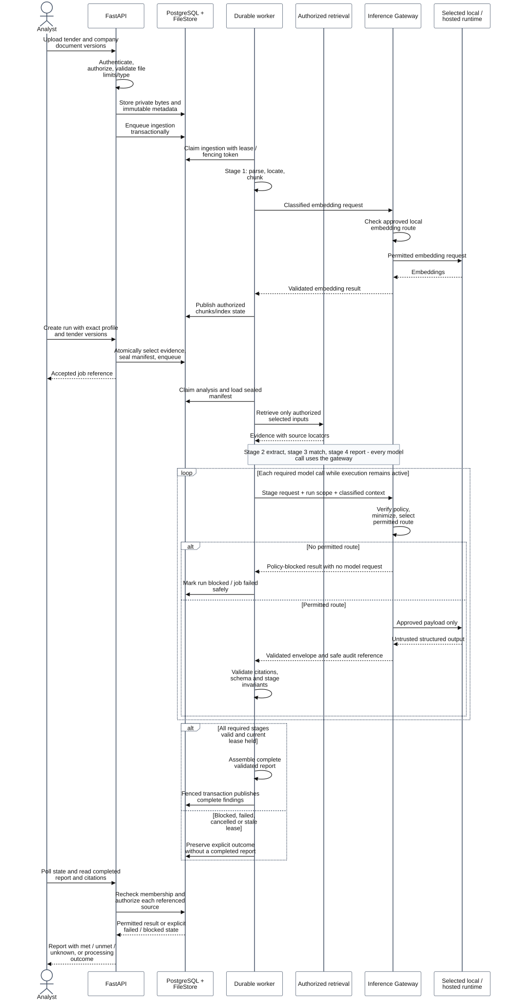

# TenderGuard architecture

TenderGuard is designed as a web application for checking a tender package against
an SME's own documentary evidence. It preserves source locations, distinguishes
supported conclusions from missing evidence, and controls which context can reach
a model provider. This package supplies the architectural description, diagrams,
data model and integration contracts for TG-R04 and predefence component 7.

The [proposal](../project-proposal/proposal.md) defines the intended product.
The repository currently implements the [relational database foundation](../database/database.md),
migration runner and database checks. The interface, authentication, RLS, parsing,
retrieval, worker, agents and Inference Gateway below are **planned components**.
A completed design is not evidence that their runtime controls already work.

## Package contents

| View | Editable source | Readable export | Purpose |
| --- | --- | --- | --- |
| System context | [context.mmd](src/context.mmd) | [context.svg](export/context.svg) | Users, external systems and the external model boundary |
| Use cases | [use-cases.mmd](src/use-cases.mmd) | [use-cases.svg](export/use-cases.svg) | Actors and requirement-linked actions |
| Components | [components.mmd](src/components.mmd) | [components.svg](export/components.svg) | Responsibilities, interfaces and the four processing stages |
| Entity relationships | [data-model.mmd](src/data-model.mmd) | [data-model.svg](export/data-model.svg) | Existing tables and tenant-aware relationships |
| Analysis sequence | [analysis-flow.mmd](src/analysis-flow.mmd) | [analysis-flow.svg](export/analysis-flow.svg) | Ingestion, sealed inputs, policy checks and result publication |
| Deployment | [deployment.mmd](src/deployment.mmd) | [deployment.svg](export/deployment.svg) | Private services, file storage and controlled model egress |

[Integration contracts](contracts.md) define the proposed API, stage inputs,
citations, outcomes and lifecycle. The
[supplied supervisor diagram](reference/supervisor-architecture.svg) is retained
as a design input. Its scaffold implementation labels do not describe the current
TenderGuard checkout; the implementation statement above takes precedence.

## Refinements of the supplied architecture

| Design area | TenderGuard decision and reason |
| --- | --- |
| Main request path | Retain browser, Caddy, Next.js, FastAPI, PostgreSQL, processing stages and a Privacy Gateway. Call the gateway **Inference Gateway** consistently in these diagrams; it includes the privacy policy boundary. |
| Company-specific analysis | Add explicit company-profile versions and supporting document versions alongside tender inputs. A tender summary alone cannot establish a supplier's documentary fit. |
| Execution | Use a durable worker and transactional PostgreSQL job enqueue for the first integrated workflow. In-process background tasks are insufficient for the proposed crash-recovery contract. No Redis or general workflow framework is required by this design. |
| Privacy | Require policy authorization of the complete context, not just identifier replacement. Masking personal identifiers does not automatically permit commercially sensitive content to leave. |
| Gateway placement | Plan a small internal Inference Gateway service so provider credentials and permitted external model access have one boundary. The API and worker use its scoped interface; the stages remain modules in one worker, not separate microservices. |
| Models | Local embeddings form the proposed retrieval baseline; model and dimensions need selection. Local generative inference and adaptation are optional. Hosted open-weight models still count as external processing. Routing is decided per call, not permanently by agent name. |
| Legal flags | Separate documentary matching from legal applicability. An unverified reference corpus or applicability rule yields `legal_unknown`; no unrestricted legal audit is promised. |
| Storage | Retain PostgreSQL 17 and private file references. Vectors, RLS, audit, sealing and review persistence require later migrations; they are not present merely because a diagram includes them. |
| Project tooling | GitHub stores code, reviewed documents and evidence; Notion coordinates tasks. Neither GitLab nor YouTrack is required. |

The supervisor's illustrated fixed embedding dimension, hosting cost, workload
capacity and partial implementation labels are not adopted as measured facts.
Technology benchmarking remains a separate deliverable under component 5.

## Scope and consistency matrix

The `AR-*` identifiers below are **working architecture references** derived from
the proposal's core workflow and objectives. They provide traceability while the
separate requirements specification is being prepared; they are not a claim of
supervisor approval. Reconcile them with component 6 without losing the mapping.
Core references must remain covered by both a use case and a component.

| Reference and required behaviour | Use cases | Responsible components | Data / verification anchor |
| --- | --- | --- | --- |
| AR-01 Active membership and role-based actions | UC-01, UC-08 | Identity and authorization; Next.js interface; Caddy | `users`, `memberships`; anonymous, inactive and viewer-write cases |
| AR-02 Company-profile and evidence versions | UC-02 | Document and company service; Private FileStore | `company_profile_versions`, `company_evidence`; applicability and exact-version references |
| AR-03 Validated text-based PDF/DOCX ingestion | UC-03 | Document and company service; Job runner; ingestion | `document_versions`, `chunks`; invalid, oversized, empty and unsupported-file outcomes |
| AR-04 Atomic requirements with tender citations | UC-04 | Requirement extraction; Authorized retrieval | `requirements`, `analysis_run_documents`; every citation belongs to a selected input |
| AR-05 Company-specific met/unmet/unknown findings | UC-04 | Documentary matching; Authorized retrieval | `findings`; met/unmet require applicable company evidence |
| AR-06 Inspectable reports and both sides of evidence | UC-05 | Run / report / review service; Next.js interface | Authorized run, finding, document and source-locator reads |
| AR-07 Grounded answers with insufficient-evidence handling | UC-06 | Question-answer service; Authorized retrieval; Inference Gateway | Run-scoped evidence references; unsupported answer withheld |
| AR-08 Human review and new runs after revisions | UC-07 | Run / report / review service; Document and company service | Immutable versions/results; planned review events and sealed run selections |
| AR-09 Organization isolation and controlled processing | UC-04, UC-06, UC-08 | Identity and authorization; Inference Gateway; PostgreSQL; Private FileStore; safe audit | Foreign-organization denial, blocked routes and observed outbound payload checks |
| AR-10 Durable processing and visible non-success states | UC-04 | Job runner; Run / report / review service; Next.js interface | `processing_jobs`; planned lease fencing, run lifecycle and retry cases |
| AR-11 Russian/Kazakh document processing | UC-03, UC-04, UC-06 | Ingestion; Authorized retrieval; requirement extraction; Question-answer service | Language-labelled fixtures and separate quality measurements |
| AR-12 Bounded risk flags and separate legal uncertainty | UC-04, UC-05 | Documentary matching; risk and report | Evidence-backed flags, transparent aggregation, `legal_unknown` when unresolved |
| AR-13 Reproducible baseline and staged evaluation | UC-09 | Offline evaluation harness; same worker, retrieval and gateway contracts | Frozen permitted inputs, model/configuration manifest, metrics and retained failures |

Automatic bid submission, payments, digital signatures, market-wide crawling,
award prediction and every procurement category are outside the core scope.
OCR, downloadable reports, model adaptation and local generation are extensions
with their own acceptance checks; none may silently bypass the core controls.

## System context



The analyst obtains documents through permitted channels and uploads them; no
automated integration with procurement portals is assumed. Authorized managers
read reports, owners control membership and policy, and the evaluator runs
permitted research fixtures. Hosted inference is the explicit external processing
boundary. Browser delivery of an authorized report is a separate access decision;
permission to read a document is not permission to send it to a model provider.

## Actors and use cases



Actor boxes use the UML `actor` stereotype and use cases use oval shapes. An owner
may also act as an analyst; a viewer has read access only. Every action rechecks
active membership server-side. The research evaluator uses a controlled harness
and permitted fixtures; this role does not grant unrestricted production access.

| Role | Permitted product actions | Boundary |
| --- | --- | --- |
| `member` | Manage permitted company/tender evidence, start analysis, ask questions, review findings and read reports | Cannot manage organization membership or processing policy |
| `viewer` | Read permitted reports and resolve their cited sources | Cannot upload, start runs, create reviews or change policy; persisted QA creation is an analyst action |
| `owner` | Analyst actions plus membership, policy and permitted audit administration | Administrative changes remain auditable; owner is not the database superuser |

## Component responsibilities



FastAPI hosts the application modules; a separate worker performs durable
processing. Stage 1 is a technical ingestion stage and does not require an LLM
agent. Stages 2–4 use bounded extraction, matching and reporting interfaces.
Authorized retrieval is shared with question answering. The Inference Gateway
handles embedding and generation requests, including repair and evaluation calls.
The chart shows logical stores and modules, not a separate container for every box.

| Component | Responsibility and boundary | Implementation lead / proposed location |
| --- | --- | --- |
| Caddy and Next.js interface | Same-origin routing; profile/upload/report screens; citations and job states; no provider secrets in the browser | Ramazan coordinates `frontend/`; each member implements their feature screens |
| Identity and authorization | Verified session, active membership, role checks and server-derived organization context | Ramazan, `backend/app/auth/` |
| Document and company service | File validation, version creation, evidence selection and authorized file access | Rassul, `backend/app/documents/`, `backend/app/company/` |
| Run / report / review service | Atomic run assembly, authorized result reads and append-only human reviews | Rassul, `backend/app/analysis/` |
| Question-answer service | Bound questions to authorized evidence and validate supported answers | Daniyar with Rassul, `backend/app/qa/` |
| Job runner | Transactional enqueue, claim/lease, retries, cancellation and fenced publication | Rassul, `backend/app/jobs/` |
| Ingestion and Authorized retrieval | Parsing, canonical text, locators, local embeddings and filtered lexical/dense retrieval | Daniyar, `backend/app/ingestion/`, `backend/app/rag/` |
| Requirement extraction | Atomic values/conditions with verifiable tender references | Daniyar; Rassul integrates typed stages in `backend/app/agents/` |
| Documentary matching; risk and report | Apply company evidence, preserve unknowns and assemble traceable findings | Rassul with Daniyar, `backend/app/agents/`, `backend/app/analysis/` |
| Inference Gateway and local adapters | Enforce routes, minimize context, validate destinations and capture safe audit; local runtime is isolated from public access | Ramazan with Daniyar, `backend/app/privacy/`, `backend/app/providers/` |
| PostgreSQL and Private FileStore | Relational integrity, restricted reads, immutable references and private bytes | Rassul owns persistence; Ramazan owns runtime isolation and deployment |
| Safe audit | Actor, organization, run, policy, route and result code without raw confidential payloads | Ramazan with Rassul, `backend/app/audit/` |
| Offline evaluation harness | Fixed baselines and development/test separation; same controls as the application | Daniyar coordinates `backend/evaluation/`; all members supply subsystem evidence |

Locations are proposed module boundaries, not directories already implemented.
The gateway can reuse the backend package in a separate process. Avoid introducing
an agent framework, message broker or additional datastore without a demonstrated
requirement and a component-5 decision.

## Data model and required evolution



This ER view reflects the existing migration tables. Every tenant-owned reference
retains `organization_id`; global users are linked to organizations by membership.
An analysis run selects a specific profile version and exact tender document
versions. Requirements point to selected tender chunks. A finding's company
evidence must belong to the run's profile version. The optional job-target edges
are exclusive: the SQL check permits a document ingestion target or an analysis
run target, never both. Infrastructure migration history is omitted.

The [SQL migrations](../../db/migrations/) and
[database contract](../database/database.md) are authoritative for implemented
columns and constraints. Their immutable rows do not yet seal related collections,
restrict reads or establish factual citation support.

| Planned evolution | Why the existing schema is insufficient | Required invariant |
| --- | --- | --- |
| Profile evidence sealing | Evidence can currently be appended to an existing profile version | Atomically finish a profile version and its evidence, then seal it; insertion and sealing take the same parent lock so a concurrent insert cannot bypass the seal |
| Run company-evidence selection and sealing | The run currently selects tender documents but not an immutable list of company-evidence rows | Add a selected-evidence association and lifecycle seal; retrieve only those selected rows, with same-profile and same-organization constraints |
| Mutable run-execution record | `analysis_runs` is immutable and has no execution state | Store operational state separately; never update an immutable run to mark progress |
| Lease fencing and request fingerprints | Expiry and idempotency fields alone do not stop stale workers or changed-payload key reuse | Add a fencing token and request fingerprint; publish only under the current lease and reject a reused key with a different request |
| Structured requirement/risk fields | Current requirements and findings contain only the initial evidence/explanation fields | Add validated condition/value/unit/language and bounded risk data through forward migrations, preserving existing rows |
| Multiple finding citations | A current finding has one primary company-evidence reference, not a full set of evidence passages | Keep the primary anchor and add citation rows for tender/company passages; validate every referenced chunk against the sealed inputs |
| Human reviews, QA records and safe audit | These persistence models are not yet implemented | Append new review/QA/audit records with actor and access context; never overwrite machine findings or log private prompts |
| RLS, vectors and model configuration | Neither RLS nor vector columns/indexes currently exist | Use restricted runtime roles and server-scoped transactions; choose embedding dimensions before creating an index, and test filtered retrieval |

These are migration requirements for later implementation tasks, not SQL changes
made by TG-R04. Exact table/column names for the new records remain an integration
decision. Do not edit applied migrations to make this diagram appear implemented.

## Processing and failure semantics



Uploads and analysis are separate jobs. Analysis requires successfully ingested
inputs, an exact profile version and an atomically sealed selection. Each stage
validates its input and output; documents and model responses are untrusted data.
An unknown compliance finding is a valid analytical outcome. A blocked route,
parser failure, exhausted retry or invalid model response is a processing outcome
and must not be presented as a completed unknown-filled report.

Workers claim jobs in a short transaction and release database locks before model
calls. A lease/fencing check protects final publication from a stale worker.
Only one complete, validated set of findings is published as a completed run;
partial stage artifacts remain distinguishable from a final report. The detailed
[stage and lifecycle contracts](contracts.md#execution-and-persistence) define
the required transitions and the mapping to current job statuses.

The single-prompt RAG baseline and staged pipeline use the same permitted frozen
inputs and gateway policy. Differences in retrieval settings, model budget or
hardware must be recorded rather than attributed to agent coordination alone.

## Trust boundaries and privacy controls

| Boundary / threat | Required control | Verification evidence to obtain |
| --- | --- | --- |
| Browser to API: forged organization or role | Validate the session and active membership; a selected organization ID is a lookup key, not authority | Missing/expired session, inactive member, foreign organization and viewer-write requests |
| API/worker to PostgreSQL: unscoped reads | Non-owner runtime roles, no `BYPASSRLS`, fail-closed RLS and transaction-local verified organization context | Two-organization reads/writes, missing context and reused connection cases |
| Document to parser/model: hostile content | Type/resource limits, disabled external document fetches, isolated parsing, bounded tools and schema/citation validation | Oversized/archive-expansion cases, remote relationship links and prompt-injection fixtures |
| Retrieval to a stage: overbroad context | Organization, sealed manifest, selected company evidence and document-role filters; ranking never supplies authorization | Foreign chunk, unselected revision and later-added company-evidence cases |
| Application to hosted inference: private context disclosure | One Inference Gateway, independently checked route policy, minimized payload, server-controlled destination and no silent fallback | Capture every embedding/generation/repair/retry call; blocked fixtures must emit no forbidden payload |
| Local stage output to hosted stage | Propagate the highest applicable restriction to derived findings, summaries and citations | A local private match cannot enter a hosted report prompt merely because raw identifiers were removed |
| Report/citation to browser | Authorize each report, document and source resolver; restricted file store, no public object paths | Guessed run/file/chunk IDs, old membership and cross-organization citation requests |
| Operational data and backups | No raw prompts, secrets or restoration maps in ordinary logs; restricted backups and retention policy | Error-path inspection, permitted audit access and database/file restore checks |

The current SQL classification is only `public` or `private`. Finer personal,
commercial and operational categories belong to the planned policy model; they
must not be described as existing enum values. Private input and derived private
output remain restricted unless an explicit approved transformation permits
transfer. Local processing still requires access controls, safe logging and
resource isolation.

## Deployment boundary



Caddy is the intended public entry point. PostgreSQL, workers, file storage,
model runtimes and the internal gateway endpoint are private. The gateway has the
approved model-egress identity; API and worker processes must not have a direct
provider route or provider credentials. Internal network attachment alone is not
proof of enforcement: destination allowlists, redirect handling, credentials and
host/container egress rules require explicit deployment checks under Ramazan's
tasks. Provision model artifacts through a controlled setup process rather than
enabling arbitrary worker downloads.

The existing Compose file provisions only PostgreSQL for local development.
This is a deployment target, not a runnable production topology. Hardware, model
memory, concurrency, backups and cost must be measured or confirmed before a
hosting commitment. Application rollback must remain compatible with forward
database migrations and the selected file snapshots.

## Integration decisions and review

| Decision / handoff | Owner and task | What must be confirmed |
| --- | --- | --- |
| Extraction, embedding and citation contract | Daniyar, retrieval/extraction tasks and TG-D01 | Model identity, dimensions, parser/locator rules, RU/KK development results and schema-compatible outputs |
| API, sealing and jobs | Rassul, TG-R07/TG-R08/TG-R09 | Supported authentication context, migration plan, worker fencing and atomic publication |
| Privacy and runtime boundary | Ramazan, TG-T03/TG-T06/TG-T07/TG-T09 | Data routes, role checks, retention, RLS and gateway/egress enforcement |
| UX representation | Ramazan with all members, TG-T04/TG-T08 | Fields and states in the report, both sides of citations and explicit blocked/unknown outcomes |
| Predefence integration | Rassul, TG-R05; Ramazan coordinates review | Consistency with completed requirements, technology choices and actual supervisor feedback |

The contracts are ready for team review; no agreement or supervisor approval is
invented. Changes from member reviews must update the relevant source, export,
contract and traceability row together. Architecture preparation can proceed
before all M0 outputs are finished; their final alignment is an integration step.

## Rebuilding diagrams

Run from the repository root with Python and Node.js/npm available:

```console
python docs/architecture/render.py
```

The renderer invokes Mermaid CLI pinned to `12.0.0` and may download its tooling
and browser on first use. To use an existing CLI and Chrome installation:

```powershell
python docs/architecture/render.py --mmdc "C:/path/to/mmdc.cmd" --browser "C:/Program Files/Google/Chrome/Application/chrome.exe"
```

The first command needs network access for tooling installation, independently
of the product's runtime network policy. Sources live in `src/`, SVGs in `export/`,
and styling in `mermaid-config.json`. Edit sources and rerender; do not hand-edit
exports. The existing-table ER source mirrors the database document and must be
updated together when the authoritative schema changes.
