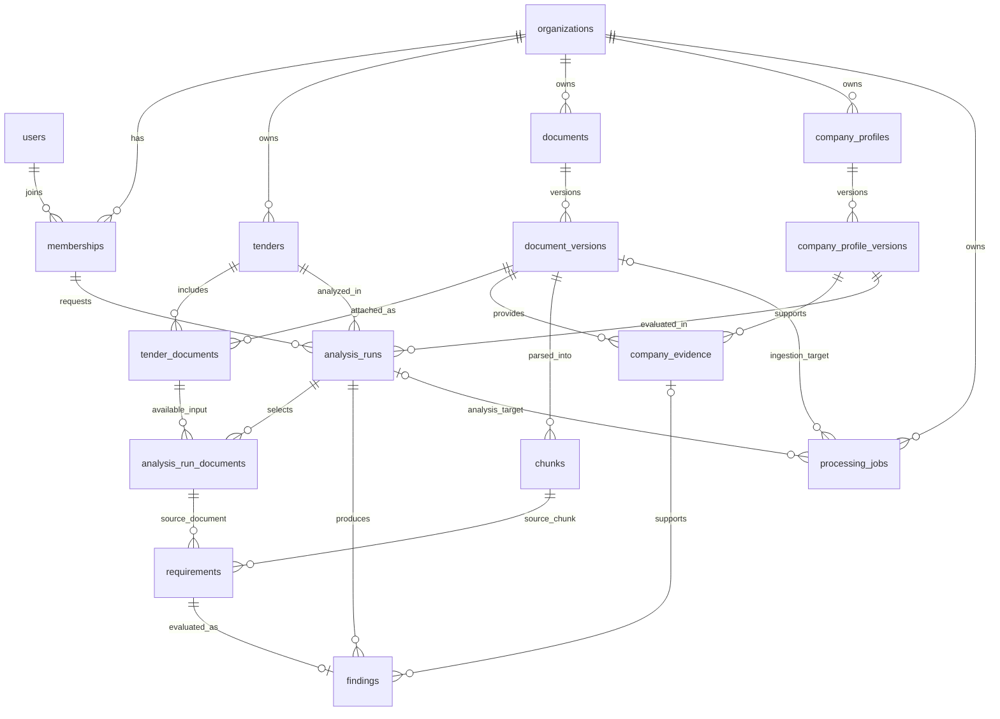

# Database foundation — TG-R06

Task owner: **Rassul Akhmetov**. Planned reviewer: **Ramazan Talgatov**.
Review and approval are still required.

[Original task](https://app.notion.com/p/TG-R06-Implement-the-database-schema-and-migrations-3fc6f6d6a08b80dbadaef9e0224feaf3?pvs=25)

The deliverable is an initial PostgreSQL schema, ordered SQL migrations, an ER diagram,
and reproducible database tests. This is the persistence foundation for the planned
TenderGuard platform; it does not implement a working analysis service.

## Acceptance evidence

| Task criterion | Implementation | Verification |
| --- | --- | --- |
| Organization keys and foreign references are consistent | Composite foreign keys include `organization_id`; findings also match their run, requirement and company profile version; source chunks match the cited document | Two-organization negative cases and same-organization mismatched input tests in `backend/tests/test_schema.py` |
| Versions are immutable | Update, delete and truncate triggers protect document versions, profile versions, evidence, chunks, run/input rows, requirements and findings | Parameterized update/delete/truncate tests; adding a new version preserves existing results |
| Clean setup and migrations are reproducible | PostgreSQL 17 Compose service, locked Python dependencies, ordered migration runner and CI | Fresh schema, repeat application, history drift, failure rollback and concurrent runner tests in `backend/tests/test_migrations.py` |

## Entity relationships

Every tenant-owned relationship uses the organization's key along with the referenced
identifier. A document or evidence ID from a different organization cannot be linked
into a run even if the UUID exists.



`processing_jobs` has exactly one target: a document version for ingestion or a run for
analysis. The diagram shows these optional edges; a SQL check enforces the exclusive
choice. `schema_migrations` is an infrastructure table and is omitted from the diagram.

## Data contracts

- **Identity:** `users.external_subject` is the future authentication provider's stable
  subject. Users join organizations through `memberships`; roles are `owner`, `member`
  and `viewer`. Authentication must validate active membership and role permissions.
- **Documents:** `documents` holds the logical title; `document_versions` records the
  immutable file metadata, content hash, privacy classification and object reference.
  Uploading a revision inserts a new version. File bytes are not stored in PostgreSQL.
  PDF and DOCX are the initial accepted metadata types; upload validation remains TG-R09.
- **Company evidence:** a profile version stores a JSON object of company attributes.
  Evidence references an exact profile version and uploaded document version. A run
  references one specific company profile version, preserving that version's attributes.
- **Retrieval:** chunks preserve their document version, chunker version, ordinal, text,
  offsets and source locator. Vector dimensions and indexes are deferred until the
  embedding contract is selected in TG-D08/TG-D14.
- **Analysis:** a run records its tender, requesting membership, company profile version
  and configuration object. Its input rows select exact document versions already
  attached to that tender. Each requirement cites a chunk from one of those inputs.
- **Findings:** values are `met`, `unmet` or `unknown`. Both `met` and `unmet` require
  company evidence from the run's profile version. Missing evidence yields `unknown`.
  One requirement has at most one finding in a run; corrected results use a new run.
- **Jobs:** organization-scoped idempotency keys, target checks and bounded attempt
  counts prepare the schema for TG-R08. Status transitions, leases, retry logic and
  worker execution are not implemented by this task.

The database checks relational consistency, not the factual correctness of an LLM's
claims. Citation text matching, offsets, evidence interpretation and configuration
validation belong to ingestion, agent and evaluation tasks.

## Migration lifecycle

Run from `backend/` using an owner connection supplied through `DATABASE_URL`:

```console
uv run python -m app.db.migrate status
uv run python -m app.db.migrate
uv run python -m app.db.migrate status
```

Migrations are `db/migrations/NNNN_description.sql`, starting at `0001` without gaps.
The runner takes a transaction-scoped advisory lock, verifies the applied history,
and applies the entire pending batch in one transaction. A repeat invocation is a
no-op. Concurrent invocations serialize and do not duplicate migrations.

`schema_migrations` records each filename and SHA-256 checksum. Checkout line endings
are normalized before hashing. Changing, renaming, dropping or introducing unknown
applied migrations causes the runner to stop. Add a new migration instead of editing
one that has been shared/applied. SQL migrations must be transaction-compatible; do
not put transaction control or `CREATE INDEX CONCURRENTLY` in these files.

On failure the pending batch and its history inserts roll back together. Previously
committed migrations remain intact. There are no automatic down migrations: review a
forward repair migration or restore a database backup. Backups and deployment migration
procedures are later platform tasks.

The CLI requires an environment variable, not a command-line password. Errors report
SQLSTATE without printing DSNs, credentials or row contents. Keep credentials in the
ignored local `.env` or a secret store, and never commit a database dump.

## Security boundary and remaining dependencies

Composite foreign keys prevent incorrect cross-organization **links**. They do not
restrict `SELECT` access. This schema has no row-level security, API authentication,
runtime role or request authorization yet. The Compose user is a development/migration
owner; it must not become the API's runtime identity. TG-T06 and TG-T07 must provide
authentication, non-owner runtime grants, RLS policies and read-isolation tests before
real confidential data is accepted.

Immutable rows preserve existing records, but related collections can still receive
new rows. In particular, a run's input manifest and a profile version's evidence set
are not sealed by a lifecycle transition yet. TG-R08 must define atomic input assembly
and sealing before processing; this task does not claim complete run reproducibility.
Snapshot triggers are integrity guardrails, not protection against a database owner
who can alter tables or disable triggers. Retention/deletion and administrative purge
procedures require a separate reviewed design.

The storage key is a logical reference beginning with the organization's UUID. It is
not a filesystem access policy; FileStore must validate resolved paths and authorize
every access in TG-R09. Model calls, privacy routing, network egress controls and vector
retrieval are also outside this migration task.

## Implementation references

- [PostgreSQL 17 constraints](https://www.postgresql.org/docs/17/ddl-constraints.html):
  composite references, unique keys and row checks.
- [PostgreSQL 17 advisory locks](https://www.postgresql.org/docs/17/explicit-locking.html#ADVISORY-LOCKS):
  transaction-scoped migration serialization.
- [Psycopg transaction contexts](https://www.psycopg.org/psycopg3/docs/basic/transactions.html):
  explicit transactions over an autocommit connection.
