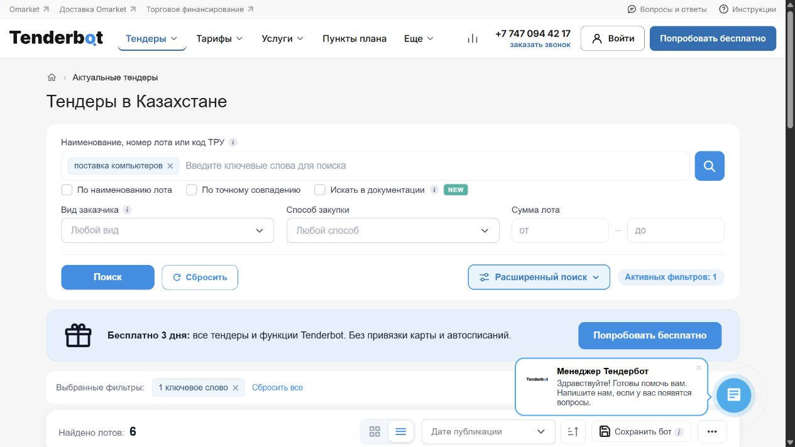
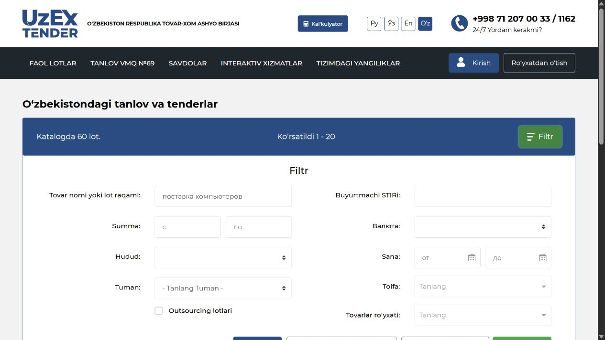
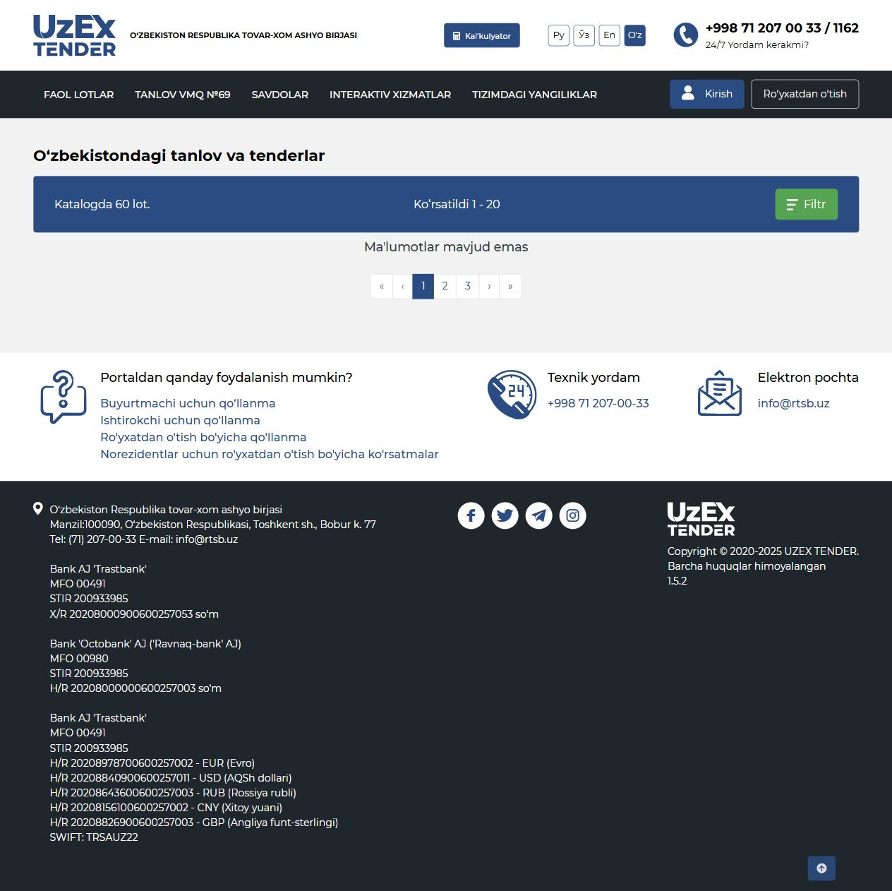
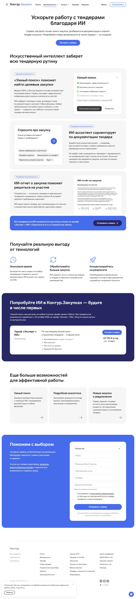

# Existing-system observation log

This log supports the [comparison matrix](../existing-systems.md).
Checks used public pages without an authenticated account.

## Shared discovery scenario

An SME seeks computer-supply opportunities. Submit the identical generic query
`поставка компьютеров` to the public search of Tenderbot and UZEX eTender,
inspect the visible result state and note restrictions. Do not add jurisdiction,
amount or category filters. The query contains no company-confidential data.

The two systems index different procurement collections. This scenario checks
interaction and access only; it is not an equal-corpus search benchmark, an AI
evaluation or a test of legal compliance.

## T01 Tenderbot public search

**Source:** [Tenderbot](https://tenderbot.kz/), matrix source S01.

1. Open the public homepage without signing in.
2. Enter the shared query in the procurement search field and submit it.
3. Inspect the resulting lot-search page, selected keyword, filters and cards.

**Observed:** the result URL contained the submitted query; the selected-keyword
chip remained visible and the page displayed six results. Result cards exposed
some information while buyer/procurement details were partly subscription-gated.
A three-day trial invitation was visible but not activated. A documentation-search
checkbox was visible but was not selected for a separate check.

**Interpretation:** public query execution and a subscription boundary were
observed. Relevance, completeness, attachment search, alerts and any generated
analysis were not evaluated. The number six is a transient UI observation, not
a benchmark score.

**Result URL:** [Tenderbot query result](https://tenderbot.kz/lots?sort_col=lots.created_at&sort_type=desc&searchstr=%D0%BF%D0%BE%D1%81%D1%82%D0%B0%D0%B2%D0%BA%D0%B0+%D0%BA%D0%BE%D0%BC%D0%BF%D1%8C%D1%8E%D1%82%D0%B5%D1%80%D0%BE%D0%B2&page=1).

The screenshot records the query, filter controls, trial invitation and displayed
count. The access-boundary observation above comes from inspecting the result
cards; it is not all visible in this viewport.

## T02 UZEX public search

**Source:** [UZEX eTender](https://etender.uzex.uz/), matrix source S11.

1. Open the public portal and follow the visible link to additional tenders.
2. On the [lot catalogue](https://etender.uzex.uz/lots/2/0), open its filter.
3. Enter the shared query into the product-name/lot-number field and submit.
4. Inspect the result area, then reopen the filter to confirm the retained query.

**Observed:** the portal displayed a no-data message after submission, while the
catalogue header still displayed 60 lots and the range 1–20 with pagination.
Reopening the filter showed the submitted query. Region, buyer identifier,
amount, currency and date filters were visible. An Excel export control was
visible during inspection, but no export was executed.

**Language boundary:** locale controls were visible. Selecting the Russian
control did not establish a successful locale change; the inspected interface
remained Uzbek. This does not establish whether Russian queries or Kazakh
documents are supported accurately.

**Interpretation:** the filter action and an inconsistent visible result state
were observed. Do not treat the message as a verified zero-match count, compare
it with Tenderbot's count, or infer language failure. No registration, bidding,
document upload or transaction was performed.

The first screenshot records the retained query. The second records the result
message and the conflicting catalogue counter; they are separate observations
of the same submitted search.

## T03 Tenderplan API documentation

**Source:** [Tenderplan Swagger documentation](https://tenderplan.ru/api/doc/),
matrix source S05.

The rendered public documentation was inspected without entering credentials or
calling an endpoint. It exposed API operations and documented OAuth/token-based
access. A service-token IP restriction option was also described. This supports
the existence of an API contract; it does not verify authorization correctness,
endpoint availability under a particular subscription, organization isolation or
local model deployment. This documentation check is additional to the two shared
discovery checks.

## Kontur announcement capture

**Source:** [Kontur.Zakupki AI announcement](https://zakupki.kontur.ru/site/new-features/ai),
matrix source S06.

The official page distinguishes currently described smart-search access from an
advanced AI rollout scheduled for **23 October 2026**. The capture preserves
the announcement context. It is not a test of an assistant or report, and its
illustrative product examples are not experimental outputs.

## Submission-source recheck

The official [Kontur AI page](https://zakupki.kontur.ru/site/new-features/ai)
still describes cited document answers and risk/report functions, while its rollout
paragraph announces advanced access from **23 October 2026**. Treat these advanced
functions as announced rather than independently tested; recheck after the stated
rollout before presenting them as available. The page's promotional access wording
does not establish a completed paid-user test.

The [Tenderbot homepage](https://tenderbot.kz/) still documents tender discovery,
notifications and analytics, and [Tenderplan](https://tenderplan.ru/) still documents
search, analytics and team management. These source reads do not repeat the earlier
interactive searches or verify their current result counts. BiCo's public homepage
returned an access restriction to the recheck; its earlier cited evidence remains
qualified rather than being presented as a new successful observation.

## Evidence boundaries

Only public product information and generic search text were used. No confidential
company evidence, authenticated dashboard information, customer interviews or
vendor inference results are included. Screenshots preserve the sites as observed,
including their own dates and interface labels. Prices, counts, plans and rollout
claims may change; rerunning a search need not reproduce the same count.

For a later document-analysis comparison, use an authorized account and a common
permitted synthetic evidence pack. Retain the exact questions, outputs, source
locators, access plan and failures. Until that experiment is run, neither vendor
marketing examples nor TenderGuard design intentions establish measured quality.
