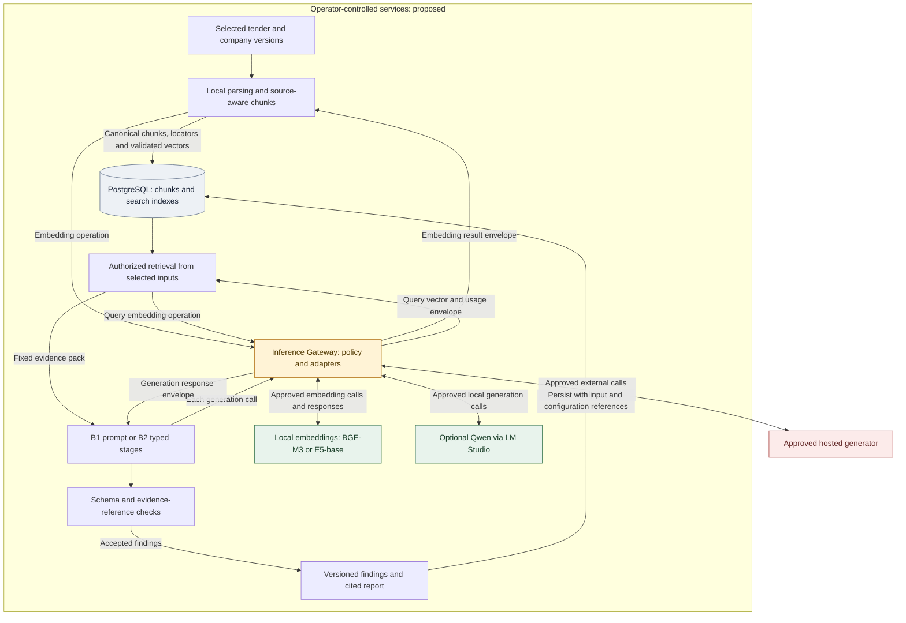
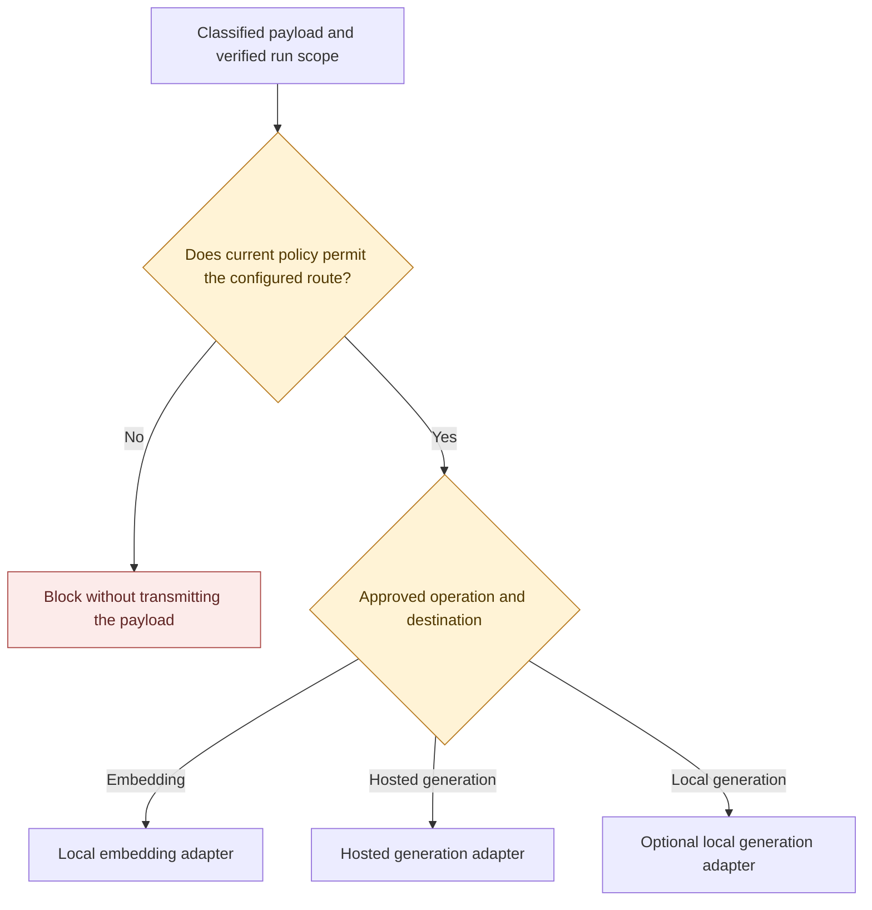

# TenderGuard: ML Stack and Architecture Decisions

## 1. Proposed stack and decision scope

TenderGuard compares a tender with a selected version of a company's supporting documents. Its ML components must find the relevant passages, preserve exact conditions and produce findings that a reviewer can check against both sources. A plausible summary without evidence does not satisfy this workflow.

The proposed implementation uses local multilingual embeddings, PostgreSQL search and a bounded Python analysis pipeline. BGE-M3 is the first embedding candidate to integrate; multilingual E5-base is the required comparator. A single-prompt RAG baseline will be implemented before evaluating the proposed extraction, assessment and reporting stages. Hosted generation is permitted only through the Inference Gateway. Local generation is an optional extension using the same evidence and validation contracts.

These are design decisions for implementation, subject to development tests and peer review. No TenderGuard accuracy, latency, memory use or privacy-test result is established by this document. The [evaluation plan](../evaluation-plan/evaluation-plan.md) defines the experiments, and the [dataset and annotation guide](../dataset/dataset-and-annotation.md) defines their reference evidence.

The [shared literature review](../literature-review/literature-review.md) supplies the research basis for multilingual retrieval, support checks, citation evaluation and context-position tests. This record turns those concerns into component choices and selection conditions; it does not reproduce a paper's training method or transfer its benchmark scores to TenderGuard.

| Layer | Proposed choice | Purpose and reason | Delivery position |
| --- | --- | --- | --- |
| Document parsing | `pypdf` for text PDF; `python-docx` for DOCX | Keep parsing local and preserve source locations before model use | Core; implementation pending |
| Chunking | Structure-aware Python splitter | Keep obligations, units and nearby context together; retain a route back to the original source | Core; tune on development data |
| Embedding | `BAAI/bge-m3`, dense mode, through Sentence Transformers | Initial multilingual representation with a documented 1024-dimensional output | First candidate; compare with E5-base |
| Embedding comparator | `intfloat/multilingual-e5-base` | Test a 768-dimensional alternative with its required query and passage preprocessing | Required experiment |
| Search | PostgreSQL 17 lexical search and pgvector cosine search | Use one organization-scoped store; measure lexical and dense retrieval separately before combining them | Relational foundation exists; search additions pending |
| Stage contracts | Pydantic schemas and explicit Python functions | Make evidence references, conditions and failure states inspectable without a general agent framework | Proposed core |
| Hosted generator | GPT-5.4 Mini, candidate snapshot `gpt-5.4-mini-2026-03-17` | Concrete structured-output candidate for the feasibility pilot; the same snapshot serves both main workflows | Conditional on policy, account access, cost and RU/KK tests |
| Optional local generator | `Qwen/Qwen3-4B-Instruct-2507`, with a separately verified quantized artifact | Assess a smaller open-weight model on available hardware without making local generation a core dependency | Optional feasibility route |
| Local generation runtime | LM Studio for the development workstation | Inspect and serve the downloaded model through a local API; retain TenderGuard's own retrieval and citations | Optional; no application integration claimed |
| Model access | Internal Inference Gateway with separate embedding and generation adapters | Centralize route authorization, context minimization, usage records and controlled failures | Required core boundary; runtime implementation pending |
| Evaluation | Python scoring over versioned exports; pytest for deterministic fixtures | Separate model quality measurements from schema and application checks | Follow TG-D01 and TG-D03 |

The API, database and privacy owners retain their responsibilities. This record selects ML interfaces and candidates; it does not replace the team's full backend, frontend, deployment or privacy technology comparisons.

## 2. Alignment with the supplied architecture

The supplied diagram provides the overall browser, API, database, worker, stages and model-gateway structure. The current [architecture](../architecture/architecture.md) refines it for explicit company evidence and versioned analysis runs. That document calls the privacy boundary the **Inference Gateway**; this record uses the same name.

Repository inspection was made against commit [`7ed02ed`](https://github.com/Tortuev/TenderGuard/commit/7ed02ed986dd1faa622a429982e34d33f1f1e593). Its implementation consists of the relational database foundation, migration tooling and database tests. The declared backend dependency is psycopg; parsing libraries, embedding runtimes, Pydantic stage models and generator adapters still need implementation and dependency locking. [R1–R3]

| Supplied diagram | Decision for TenderGuard | Reason |
| --- | --- | --- |
| Four processing stages | Retain ingestion, requirement extraction, documentary assessment and reporting | Matches the proposal; ingestion is technical processing and need not be an LLM agent |
| Fixed `vector(1024)` | Use 1024 dimensions only for the BGE-M3 index; E5-base needs a separate 768-dimensional configuration | Different model spaces must not share an index, even if dimensions happen to match |
| Hybrid search with HNSW and GIN | Start with exact authorized dense retrieval and a lexical baseline; add approximate indexing and fusion only after measurement | Establish a reference result before introducing approximation or ranking changes |
| OCR in ingestion | Detect unsupported scans explicitly; keep OCR outside the initial core path | Avoid an unimplemented OCR dependency and silently incomplete evidence |
| In-process runner before a queue | Follow the current durable-worker design and PostgreSQL job contract | Long-running analysis needs recorded retries and recovery; an in-memory task is insufficient |
| Identifier masking before hosted inference | Authorize and classify the complete payload before deciding whether any external call is allowed | Masking names or identifiers does not make commercial information unrestricted |
| Local LLM shown as a route | Retain as optional; local embeddings remain part of the proposed core retrieval design | Embedding and text generation have different workloads and delivery commitments |
| Legal corpus and legal checks | Keep legal applicability separate from documentary `met/unmet/unknown` | A retrieved legal passage alone cannot establish an applicable legal conclusion |
| Partial-implementation badges and a small VPS price | Do not treat these as current repository status or a measured deployment budget | The code and deployment evidence must establish those claims |

### Proposed ML component view



The diagram shows logical responsibilities. Stages are modules in one worker, not separate microservices. Model responses return through the gateway; embeddings are stored only after the caller validates the returned identity, dimensions and scope. The gateway does not make the result factually correct or replace authorization at database and source-read boundaries.

## 3. ADR-ML-01: local embedding model

### Alternatives and published properties

The official cards establish the properties below. They do not establish which model retrieves Kazakh tender evidence more accurately. [S1, S2]

| Criterion | BGE-M3 | Multilingual E5-base |
| --- | --- | --- |
| Exact candidate | `BAAI/bge-m3` | `intfloat/multilingual-e5-base` |
| Language basis | Published as multilingual across more than 100 languages | Multilingual model; the card warns about weaker performance for low-resource languages |
| Dense dimensions | 1024 | 768 |
| Published input limit | 8192 tokens | 512 tokens |
| Retrieval preprocessing | No additional query instruction required by the card | `query: ` for queries and `passage: ` for passages, including non-English input |
| Model licence | MIT, as declared by the model publisher | MIT, as declared by the model publisher |
| Other representations | Also supports learned sparse and multi-vector retrieval; not enabled in the initial dense comparison | Dense representation for this comparison |
| Privacy | Run within the approved operator boundary; no external embedding upload by default | Same boundary and route requirement |
| Resource implications | More dense-vector components; longer supported inputs can require more compute and memory | Fewer vector components; short input limit requires careful splitting |
| Budget implications | Local compute, memory, storage and integration effort | The same cost categories; lower vector size alone does not establish lower total cost |

### Decision and consequences

Integrate BGE-M3 dense first because it is compatible with the proposed 1024-dimensional retrieval design and permits a later long-passage experiment without changing model family. Compare E5-base before selecting the operational model. Neither model receives a preferred accuracy score before measurement.

Use Sentence Transformers for the initial dense adapters and pin the model, tokenizer and runtime versions. Keep sparse and multi-vector outputs disabled. BGE-M3's learned sparse representation is not the PostgreSQL lexical baseline.

The common experiment will use identical canonical chunk text. Each adapter applies its documented model-specific prefix and normalization. Record both complete tokenized input lengths, including prefixes, titles and special tokens; no configuration may silently truncate a requirement. Long-input BGE-M3 experiments must be separate from the common-chunk comparison.

For float32 component arrays, BGE-M3 uses `1024 * 4 = 4096` bytes per vector and E5-base uses `768 * 4 = 3072`. The pgvector `vector` value adds 8 bytes, giving 4104 and 3080 bytes respectively, before row and index overhead. For 100,000 vectors, these values occupy about 391.4 and 293.7 MiB. This is a storage calculation, not a corpus size, memory profile or speed benchmark. [S3]

### Selection rule

Compare the lexical baseline and both dense models on the development partition using Recall@5/@10, complete-evidence success@5/@10 and nDCG@10 where graded labels exist. Report Russian, Kazakh and cross-language results separately, together with index footprint, elapsed time and failures.

Prefer the candidate that retrieves complete supporting evidence within the measured resource envelope. If aggregate results conceal poor Kazakh retrieval, resolve or report that limitation before selecting a multilingual operating claim. If the candidates are close within the observed uncertainty, resource use and integration simplicity can decide the choice. The held-out test confirms the frozen choice; it does not select it.

## 4. ADR-ML-02: chunking, retrieval and persistence

### Initial development configuration

The following values are starting settings for the pilot, not task acceptance thresholds or tuned results.

| Setting | Initial proposal | Check before final evaluation |
| --- | --- | --- |
| Chunk boundary | Preserve PDF page, DOCX paragraph or table-cell provenance; subdivide long units without losing their parent context | A citation resolves to the same canonical text and immutable source version |
| Text size | Target up to 384 tokens of content; up to 48 tokens of overlap within a compatible source boundary | The complete input fits both tokenizers, including model prefixes and metadata; preserve conditions across splits |
| Ranking depth | Return up to 10 authorized candidates; score the first 5 and 10 | Report candidate shortages and unanswerable queries |
| Dense distance | Cosine ranking with recorded normalization | Query and stored vectors use the same model/configuration |
| Lexical baseline | PostgreSQL full-text search, initially with a documented `simple` configuration | Test RU/KK terms, identifiers and inflections; language-specific configurations are separate variants |
| Dense index | Exact search within the authorized selected input set for the small pilot | Establish reference recall and timing before introducing HNSW |
| Combined retrieval | Separate lexical/dense rank-fusion experiment | Select the fusion rule and parameters on development data and retain the standalone results |

`simple` full-text search is a reproducible starting point, not a claim of Kazakh morphological support. PostgreSQL ranking is not labelled BM25 unless a separate BM25 implementation is actually added and documented.

The initial store remains PostgreSQL because the project already has organization, document-version, chunk and analysis relationships there. Adding a separate vector database would add another access boundary and consistency problem before the pilot demonstrates a need. This is an engineering choice for the present scope, not a claim that PostgreSQL is universally faster.

Every retrieval operation receives verified organization context, the selected profile and document versions, a query and bounded ranking parameters. The returned set must satisfy both current access permissions and the sealed input selection. Similarity is a ranking value, not a probability that a company complies.

If HNSW is introduced, compare it with exact results under the same filters. The pgvector documentation notes that approximate index filtering can return too few matches. Tune authorized retrieval, partitions or supported iterative scans as appropriate; never remove access filters to obtain more results. [S3]

### Required database evolution

Keep source chunks separate from their model-specific vector records. A proposed embedding record identifies the source chunk, organization, model artifact/revision, tokenizer/preprocessing configuration, dimension and vector. Use separate dimension-safe tables or partitions for 1024- and 768-dimensional records. Even two 1024-dimensional models need distinct configuration identity and query routing.

Switching models requires re-embedding the selected corpus and building the corresponding index. Do not pad E5 vectors to 1024, compare vectors from different models or overwrite old configuration records needed to reproduce a run.

Current migrations deliberately defer vectors. They also permit one `company_evidence_id` per finding, whereas the warranty-conflict case needs multiple source references. Rassul and Daniyar must agree a normalized citation representation or an equivalent versioned record that preserves every source. Selecting one convenient citation and discarding the conflict is unacceptable. [R2, R3]

## 5. ADR-ML-03: typed stages and the single-prompt baseline

### Comparison

| Criterion | B1: one generation call | B2: typed extraction, assessment and reporting |
| --- | --- | --- |
| Information | Fixed authorized tender/company evidence pack | The same original evidence pack plus its own stage outputs |
| Language | Same selected generator and RU/KK fixtures | Same generator; measure whether each handoff preserves language, values and conditions |
| Licence and terms | Selected generator/provider terms apply | Same terms; stage separation adds no right to process or redistribute data |
| Privacy | One generation request still requires authorization | Every stage, retry and intermediate payload requires authorization |
| Resources | One generation call for an eligible package | Initially one call per generation stage for an eligible package; record all added calls and tokens |
| Budget | Account for input, output, errors and permitted retries | Sum all three stages; do not compare only the last reporting call |
| Engineering benefit | Simple implementation and useful reference | Explicit intermediate requirements and assessments support diagnosis and validation |
| Main risk | Omitted obligations and mixed extraction/assessment errors | Early errors can propagate; extra stages can cost more without improving findings |

### Stage responsibilities

| Stage | Input | Output | Mandatory boundary |
| --- | --- | --- | --- |
| Ingestion | Authorized immutable files and parser configuration | Canonical text, language, locators and chunks; embeddings through the approved adapter | No generation needed; unsupported scans have an explicit outcome |
| Requirement extraction | Selected tender passages and schema | Atomic obligation, scope, operator, value/unit/date where present and tender citations | Do not infer a missing threshold or merge independent obligations |
| Documentary assessment | Validated requirements and selected company evidence | `met`, `unmet` or `unknown`, rationale and separate tender/company citations | A positive or negative fit requires applicable company evidence; absence alone is unknown |
| Reporting | Validated findings and a versioned risk rubric | Requirement/evidence matrix, missing information, bounded actions and optional explanatory wording | Compute counts deterministically; generated wording cannot change statuses or invent legal approval |

Pydantic provides schema validation and a strict-mode option; it does not prove that cited evidence entails a conclusion. Apply strict field rules, status enums, bounded collections and application validators for allowed source IDs, quote spans, scope and compatible conditions. Retain failed semantic or reference checks as failures for review. [S4]

### Decision and fair comparison

Use explicit Python functions and Pydantic contracts before adding a general agent framework. The current task has a known stage order, limited tools and a small team. Dynamic planning, an additional agent runtime or separate services for every stage would need a demonstrated requirement. This choice keeps orchestration consistent with the existing worker design and makes each stage explainable.

Build B1 first, then B2. For the primary comparison, pin the same generator snapshot, embedding configuration, source/profile versions, evidence-pack hash, ordering and original permitted information. B1 receives exactly one generation call; do not hide extraction or model repair inside it. Both systems use the same deterministic validation.

B2 can use three calls and additional generated state, so the comparison isolates staging with fixed original evidence, not equal compute. For packages fitting the agreed limits, start with one extraction call, one batched assessment call and one reporting call. Any per-requirement calls, retries or segmentation change the resource record and must be declared. A deterministic report-only variant is a separate ablation if it removes the reporting generation call.

If either workflow cannot access the complete selected pack within its declared limits, apply the predefined common exclusion or segmentation rule. A segmented multi-call baseline is not silently reported as the original one-call B1. Adaptive retrieval is also a separate configuration because it can change the available evidence.

Retain B2 operationally only if its supported findings justify its measured overhead. A simpler baseline with comparable quality is an acceptable final choice. This decision does not assume that more agents improve quality.

Fine-tuning is not selected for the initial core workflow. First establish the reference corpus, retrieval baseline and error categories. Any later adaptation needs a permitted training set, family-separated held-out data, a resource profile and a comparison with the unadapted model. The published synthetic diagnostics cannot become evidence of unseen-test improvement.

### One finding through the typed interface

The following is illustrative contract data for the synthetic warranty case. Its aliases come from the annotation guide and are resolved to allowed backend identifiers before persistence; they are not database UUIDs or a measured model response.

```json
{
  "requirement_id": "SYN-03-R01",
  "condition": {
    "subject": "full_hardware_warranty",
    "operator": ">=",
    "value": 24,
    "unit": "months",
    "anchor": "acceptance"
  },
  "status": "unknown",
  "tender_citations": ["SYN-T03-v1"],
  "company_citations": ["SYN-C03-A-v1", "SYN-C03-B-v1"],
  "missing_fields": ["applicable_offer_confirmation"],
  "conflict": true,
  "explanation": "The two offers specify 12 and 36 months. Neither is established as the applicable offer."
}
```

The extraction stage preserves the 24-month minimum. Assessment retains both offers and the unresolved authority. Reporting displays the unknown and requests confirmation. A later confirmation creates a new evidence selection and assessment; it does not rewrite the original run.

## 6. ADR-ML-04: hosted generation and the optional local route

### Concrete candidates

The hosted pilot candidate is **GPT-5.4 Mini**, using the dated snapshot `gpt-5.4-mini-2026-03-17` if available to the team's account. Its official documentation lists structured output support and published token prices. It is selected for an initial bounded experiment, not because a TenderGuard quality advantage has been measured. Model availability and language performance must be checked before adoption. [S5]

For optional local generation, test **Qwen3-4B-Instruct-2507** with **LM Studio** on the development workstation. The model publisher declares Apache 2.0 and a 4.0-billion-parameter instruction model with non-thinking output. Choose and record the actual GGUF artifact, quantization, publisher, upstream revision and hash; the base model card does not certify a third-party conversion. [S6]

LM Studio supplies the local runtime, not the embedding model or TenderGuard's evidence store. Its local server supports compatible generation endpoints and schema-based structured output. Keep document parsing, retrieval, tenant scope and citations in TenderGuard rather than substituting the application's built-in document-chat workflow. Offline inference requires downloading the model and runtime first. Runtime terms must be checked separately from the checkpoint licence. [S7–S9]

| Criterion | Hosted candidate | Optional local candidate |
| --- | --- | --- |
| Language | RU/KK extraction, status and citation tests on the exact snapshot; provider descriptions are insufficient | The same language tests on the exact quantized artifact; broad multilingual claims do not establish Kazakh tender quality |
| Licence and terms | Proprietary API access under provider terms; no permission to redistribute weights is assumed | Apache 2.0 base checkpoint; verify notices, conversion provenance and separate runtime terms |
| Privacy | Data crosses the operator boundary; enable only for an explicitly authorized payload and destination | Keep inference within the approved boundary; still enforce tenant access, restricted logs and route controls |
| Resources | Network, account access, rate limits and provider response time | Model weights, runtime buffers, KV cache, system RAM/VRAM, context length and concurrency |
| Budget | Chargeable tokens, retries and any enabled tools; no free API access assumed | No hosted token fee for offline inference, but hardware, electricity, storage and integration effort remain |
| Reproducibility | Record dated snapshot, parameters, request settings and usage | Record exact weights/hash, quantization, runtime, device/offload settings and parameters |
| Failure behavior | Visible timeout, rate-limit, refusal or policy-blocked outcome | Visible loading failure, out-of-memory, timeout or blocked outcome; no silent hosted fallback |

Hosted and local runs that use different models, precision or context limits are deployment alternatives, not a clean experiment on routing alone. Keep the main B1/B2 comparison on one generator. Report any later hosted/local comparison separately with the full configuration differences.

### Route policy



An allowed route must also have an available, tested adapter. If the optional local generator is absent, a local-only generation request is blocked. The embedding route does not grant permission for generation or external transfer.

Policy covers the full context, including company facts, queries, generated intermediate outputs and repair attempts. A local assessment may contain restricted information even if the next stage is only “report writing.” It cannot move to hosted generation without authorization. Model-generated URLs and instructions inside documents cannot select the destination.

OpenAI's API data-control documentation distinguishes training use, abuse-monitoring retention and application state. API content is not used for training by default, but this is not zero retention: default abuse-monitoring logs can contain content and be retained for up to 30 days, with stated exceptions. Special retention controls require eligibility and approval. Confirm the exact endpoint and account settings; a non-storage setting alone does not establish no retention. [S10]

No real restricted company data should reach a hosted candidate before the team's policy and applicable permission requirements are resolved. The initial pilot can use permitted public documents and synthetic company evidence.

## 7. Hardware and budget feasibility

### Local feasibility profile

The development feasibility target is a workstation with 16 GB system RAM and 8 GB GPU memory, subject to the device and available memory being confirmed. It is not a reserved production server. Start the optional generator with a Q4-class artifact, one request at a time and a modest 4096-token context. Measure actual memory and output limits before increasing context or concurrency.

At four bits per parameter, a nominal 4-billion-parameter model has about 2.0 GB of weight bits before quantization metadata, non-quantized tensors and runtime overhead. At sixteen bits the nominal weight bits alone are about 8.0 GB. Neither calculation proves that the model fits an 8 GB GPU: KV cache, buffers, the operating system and other workloads also consume memory. Do not load the generator and embedding model together on the GPU until their combined peak has been measured.

First test the embedding adapter on CPU with a small batch, then profile GPU execution separately if available. Record cold loading, warm latency, peak system/GPU memory and failures. A CPU path may avoid GPU contention but is not assumed to meet a latency target.

The backend currently requires Python 3.13. Resolve and lock compatible parsing, schema and embedding dependencies in a development environment before integrating them. A CUDA or Python compatibility problem requires an explicit runtime decision; do not silently replace the repository's declared environment or claim an untested deployment.

### Cost calculation and limits

For standard text-token pricing, the hosted candidate's documentation checked on **22 October 2026** lists **USD 0.75 per million input tokens** and **USD 4.50 per million output tokens**. Recheck the actual endpoint/service tier and any applicable adjustments before running. The dated model identifier pins behavior, not a permanent price. [S5]

Use:

`generation_cost = input_tokens * input_rate / 1_000_000 + billed_output_tokens * output_rate / 1_000_000`

For illustration, 1,000,000 input tokens and 100,000 billed output tokens would cost `0.75 + 0.45 = USD 1.20` at those rates, before other charges. This is arithmetic, not a prediction of TenderGuard token use. Include every stage and retry, and include billed reasoning tokens if a reasoning setting is enabled. Disable external tools and hosted file/vector storage for this bounded text-only experiment.

The shared project budget is USD 0 to 50. Propose an initial generation-pilot ceiling of USD 10 only if that amount remains available and the team allocates it. Before paid execution, use development measurements to estimate the complete experiment, reserve room for failures and enforce a cumulative cap in the gateway. A funding or account limit pauses the run; it does not silently change the model.

With twelve held-out packages and three repetitions, an eligible one-call B1 would require 36 generation calls. A three-call B2 would require 108. Their combined minimum is 144, before retries, diagnostics or question answering. This count follows the proposed design; no calls have been executed for this record. Corpus changes or segmentation require a new estimate.

## 8. Model selection and implementation checks

### Mandatory gates before quality comparison

| Gate | Evidence needed | Action if unmet |
| --- | --- | --- |
| Permitted data and destination | Document use basis, classified context and an allowed route | Block that route and use permitted fixtures |
| Model and software provenance | Exact artifact/snapshot, licences or provider terms, runtime lock and conversion hash where relevant | Keep the candidate out of final evaluation |
| Resource feasibility | Measured memory, loading and bounded-request behavior on the intended device | Reduce declared workload on development data or reject the configuration |
| Contract compatibility | Valid schemas, selected source IDs and correct handling of unknown and failure states | Correct the adapter or pipeline before quality claims |
| Reproducible configuration | Dataset/split hashes, pack hash, model/tokenizer, prompts, distance, limits, route and scorer revision | Freeze the missing settings before accessing the test set |

After these gates, compare retrieval quality and supported status quality using TG-D01. Provisional targets remain macro-F1 of at least 0.80, complete-evidence success@5 of at least 0.85 and supported gold coverage of at least 0.80. They are project planning targets for pilot review, not model-card results or evidence that a candidate already passes. Report false passes, failures, language slices and resource costs alongside them.

### Connection to the prepared synthetic cases

| Diagnostic | Expected observation | Component it checks |
| --- | --- | --- |
| RAM: 16 GB against “at least 16 GB” | `met`; preserve equality and cite the installed-RAM statement | Extraction operator and assessment |
| RAM: storage value without RAM evidence | `unknown`; do not reuse an SSD value as RAM | Evidence/property matching |
| Delivery on 11 November after the stated 1 November anchor | `met`; retain the explicit next-day counting rule | Calendar normalization and source preservation |
| Competing 12- and 36-month offers | `unknown`; retain both company sources until applicability is established | Multiple citations and document authority |
| Foreign-organization candidate | No evidence returned or transmitted | Authorization and retrieval boundary |
| Hosted route denied by policy | Blocked processing; no company-fit label fabricated | Gateway and failure contract |

These are expected checks. Passing the small diagnostic set would not establish natural-document accuracy or complete privacy assurance.

### Implementation order

1. Agree the source, embedding and multiple-citation contracts with Rassul and the gateway route contract with Ramazan. Preserve the existing database foundation.
2. Implement text parsing and source-aware chunking, then check original-source resolution on permitted fixtures. Add and lock the required dependencies.
3. Add BGE-M3 and E5-base adapters with model-specific preprocessing, identity and dimension checks. Measure them separately on the development corpus.
4. Add the authorized lexical and exact dense baselines. Select chunking and retrieval settings using development evidence before considering fusion or HNSW.
5. Integrate the permitted generator adapter through the Inference Gateway. Build B1 and retain raw outputs, failures and usage before introducing B2.
6. Add the typed extraction, assessment and reporting stages and run the controlled cases. Compare B1/B2 on identical original evidence and the same generator.
7. Test the optional local generator only if resources and remaining time permit. Record its differences from the hosted configuration and keep it outside the core acceptance dependency.
8. Freeze the selected configuration before held-out testing. Record the peer-review comments and resulting revisions in the PR; link the reviewed artifact to TG-D04.

## 9. Sources and repository evidence

Official model properties and documentation were checked on 22 October 2026. Published specifications support candidate selection; they do not establish TenderGuard benchmark results. Resource settings and selection rules in this record are engineering proposals that require development measurements.

### Repository evidence

- **R1.** [Architecture at the inspected revision](https://github.com/Tortuev/TenderGuard/blob/7ed02ed986dd1faa622a429982e34d33f1f1e593/docs/architecture/architecture.md), including its supplied-architecture refinements, component boundaries and current implementation status.
- **R2.** [Integration contracts at the inspected revision](https://github.com/Tortuev/TenderGuard/blob/7ed02ed986dd1faa622a429982e34d33f1f1e593/docs/architecture/contracts.md), covering source locators, authorized retrieval, stages, gateway policy and persistence gaps.
- **R3.** [Analysis and jobs migration](https://github.com/Tortuev/TenderGuard/blob/7ed02ed986dd1faa622a429982e34d33f1f1e593/db/migrations/0002_analysis_and_jobs.sql) and [backend dependencies](https://github.com/Tortuev/TenderGuard/blob/7ed02ed986dd1faa622a429982e34d33f1f1e593/backend/pyproject.toml).
- **R4.** [Requirements specification](../requirements/requirements.md), particularly FR-05, FR-07, FR-08, FR-09, FR-13, FR-15 and FR-16; [evaluation plan](../evaluation-plan/evaluation-plan.md); [dataset and annotation guide](../dataset/dataset-and-annotation.md).

### Official technical sources

- **S1.** BAAI. [BGE-M3 model card](https://huggingface.co/BAAI/bge-m3): multilingual scope, representations, dimensions, input length, licence and query handling.
- **S2.** intfloat. [Multilingual E5-base model card](https://huggingface.co/intfloat/multilingual-e5-base): dimensions, input limit, prefixes, normalization, licence and language limitations.
- **S3.** pgvector maintainers. [pgvector documentation](https://github.com/pgvector/pgvector): vector storage, distance operators and filtered approximate-index behavior.
- **S4.** Pydantic. [Strict mode](https://docs.pydantic.dev/latest/concepts/strict_mode/): validation options; application evidence checks remain separate.
- **S5.** OpenAI. [GPT-5.4 Mini documentation](https://developers.openai.com/api/docs/models/gpt-5.4-mini): snapshot, structured output support and published token rates.
- **S6.** Qwen. [Qwen3-4B-Instruct-2507 model card](https://huggingface.co/Qwen/Qwen3-4B-Instruct-2507): model size, non-thinking mode and Apache 2.0 declaration.
- **S7.** LM Studio. [Offline operation](https://lmstudio.ai/docs/app/offline).
- **S8.** LM Studio. [Compatible API endpoints](https://lmstudio.ai/docs/developer/openai-compat).
- **S9.** LM Studio. [Structured output](https://lmstudio.ai/docs/developer/openai-compat/structured-output).
- **S10.** OpenAI. [API data controls](https://developers.openai.com/api/docs/guides/your-data): training use, retention and eligibility for special controls.
- **S11.** pypdf. [Text extraction documentation](https://pypdf.readthedocs.io/en/stable/user/extract-text.html): local extraction and image-only document limitations.
- **S12.** python-docx. [Documentation](https://python-docx.readthedocs.io/en/latest/): document, paragraph and table interfaces.

The parsing choices use the local interfaces described in S11 and S12. Licence notices and compatible versions for every added dependency must be retained in the implementation lock and distribution record. Rassul's substantive review and any resulting corrections are still required before TG-D04 is marked complete.
